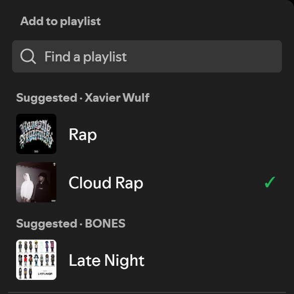
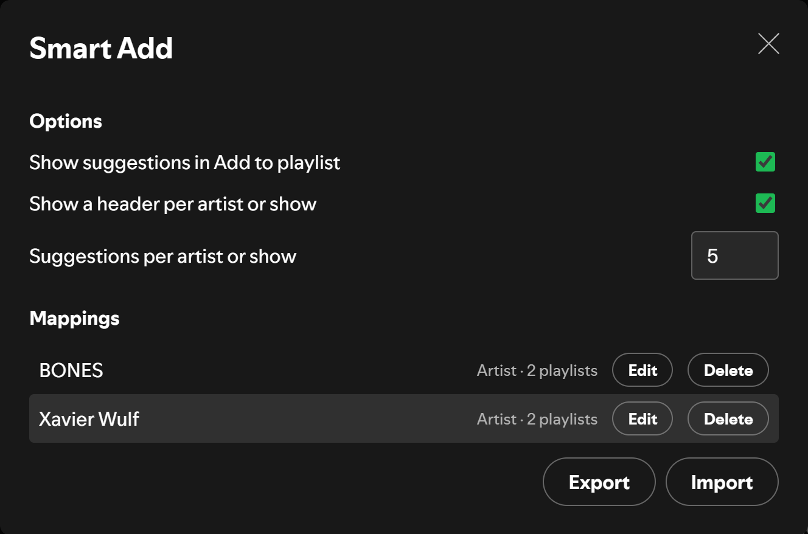

# Smart Add

<!-- site:skip-start -->
**Documentation:** https://spicetify.yusufaf.dev/smart-add/
<!-- site:skip-end -->

Map artists and podcast shows to playlists, and Spotify's **Add to playlist** menu shows those playlists first. Map Drake to your Rap and R&B playlists once, and every Drake song after that is one click from both.



## Features

- **Suggested section**: Your mapped playlists appear at the top of the Add to playlist menu, above Spotify's own list
- **Every credited artist**: A song with features gets one group per artist, and a playlist mapped to two of them is listed once
- **One click**: Clicking a suggestion adds the song right away and shows a confirmation. Playlists that already have it show a ✓
- **No duplicates**: Smart Add checks the playlist before adding, so a song never goes in twice
- **Podcasts too**: Map a show, and its episodes suggest your podcast playlists
- **Out of the way**: Typing in "Find a playlist" hides the section, and songs without a mapping leave the menu untouched
- **Backup and restore**: Export your mappings to JSON and import them on another computer
- **Theme-agnostic**: Uses Spicetify's theme colors
- **Lightweight**: Single file, no dependencies, no build step

## Installation

Requires [Spicetify](https://spicetify.app/docs/getting-started), installed and applied at least once. The Marketplace route also needs the [Spicetify Marketplace](https://spicetify.app/docs/customization/marketplace) custom app.

### From Spicetify Marketplace

1. In Spotify, open **Marketplace** (the shopping-cart icon at the top left) and stay on the **Extensions** tab.
2. Search for `Smart Add`. If it doesn't show up, click **Load more** (» at the bottom of the list) until it does. Marketplace loads extensions in batches and only searches the ones it has loaded.
3. Hover the **Smart Add** card, click its download button, then click **Reload now**.

### Manually

1. Download [`smart-add.js`](https://raw.githubusercontent.com/yusufaf/spicetify-smart-add/main/smart-add.js) (right-click → **Save link as…**) into your Spicetify `Extensions` folder:
   - Windows: `%APPDATA%\spicetify\Extensions`
   - macOS / Linux: `~/.config/spicetify/Extensions`
2. Enable it and apply:

   ```bash
   spicetify config extensions smart-add.js
   spicetify apply
   ```

## Usage

1. **Map an artist**: Right-click a song and choose **Map artist to playlists…** (if the song has several artists, pick one), or right-click an artist and choose **Smart Add playlists…**. Tick the playlists and click **Save**.
2. **Map a show**: Right-click an episode and choose **Map show to playlists…**, or right-click a show and choose **Smart Add playlists…**.
3. **Add a song**: Click the ✓ button on a song row, in the now-playing bar or in the Now Playing view to open **Add to playlist**. (On a song you haven't saved, that button is a **+** and the first click saves it to Liked Songs; click it again to open the menu.) Your mapped playlists are under **Suggested**. Click one to add the song.
4. **Manage everything**: Open your profile menu (top right) and choose **Smart Add**. You can edit or delete mappings, change options, and export or import a backup.



### Options

| Option | Default | What it does |
|--------|---------|--------------|
| Show suggestions in Add to playlist | On | Turns the Suggested section on or off |
| Show a header per artist or show | On | Shows "Suggested · Artist" above each group; off shows one "Suggested" header |
| Suggestions per artist or show | 5 | Most playlists you can still add to shown per group. Playlists that already have the song don't count toward it |

## Limitations

- Suggestions appear in the **Add to playlist** window that opens from the ✓ button on song rows, the now-playing bar and the Now Playing view. Spotify's right-click **Add to playlist** submenu and multi-song selections are not covered yet.
- At most three groups are shown, so an add with many credited artists lists the first three that have mappings.
- Smart Add finds Spotify's menu by its structure, not its text, so it should work in any language, but it has only been tested in English. A Spotify update that changes the menu can stop the section from appearing. When that happens Spotify's own menu keeps working as normal.

## How It Works

Mappings are stored in Spotify's `localStorage` (`smart-add-data`, `smart-add-config`), keyed by artist or show URI. When the Add to playlist window opens, Smart Add looks up who made the song you clicked, finds your mapped playlists, and adds its section above Spotify's list. It only does this when it is sure which song opened the window. If the lookup is slow or the click is ambiguous, it shows nothing rather than a wrong suggestion.

## License

MIT
